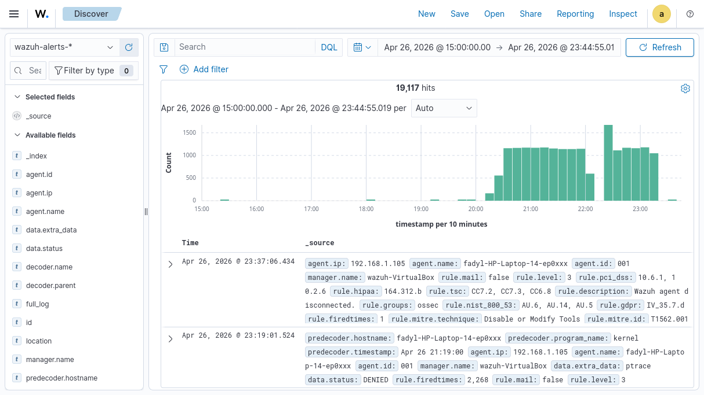
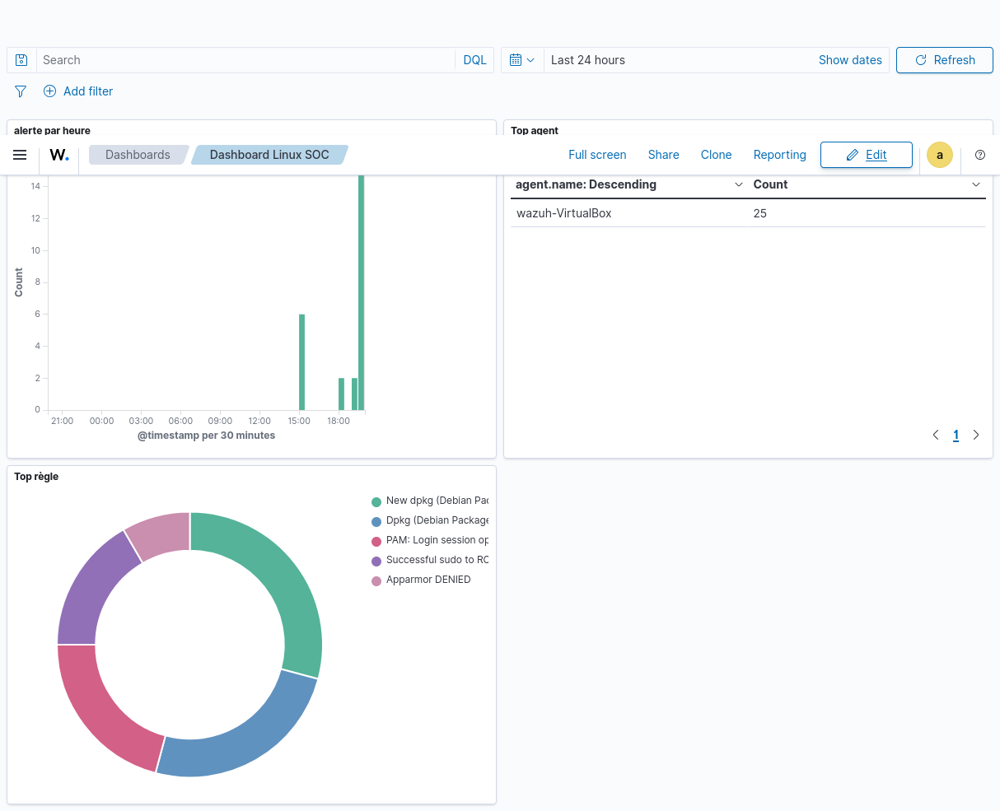
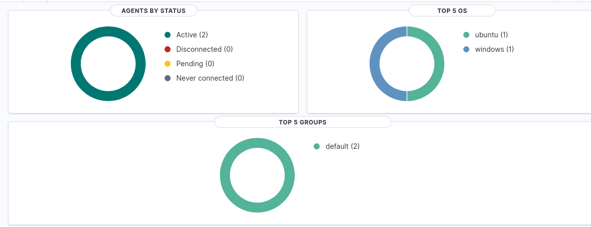
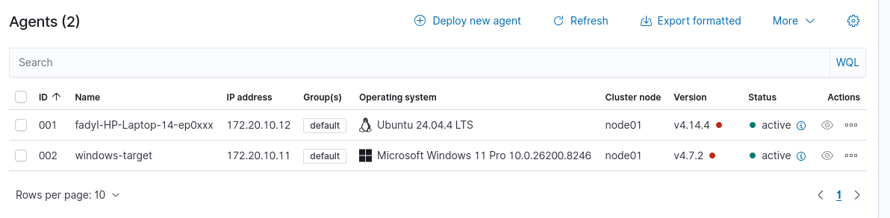
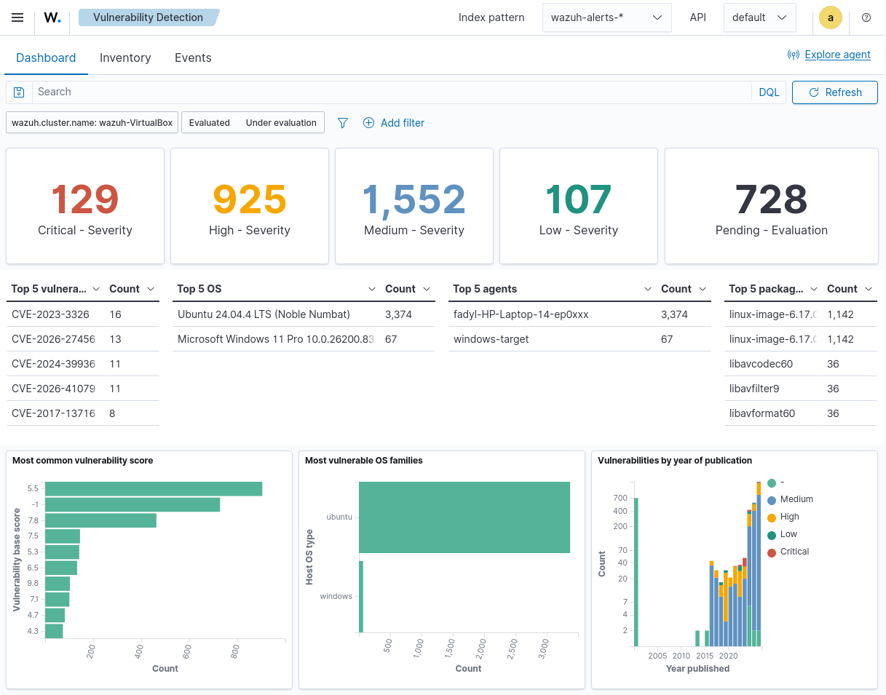

# 🛡️ Projet SOC Wazuh — Centre Opérationnel de Sécurité

> **Auteurs :** Fadyl ROUFAI  
> **Promotion :** 2026 | **Spécialité :** Cybersécurité / SOC  
> **Date :** Mai 2026

---

## 📌 Description

Ce projet consiste en le déploiement complet d'un **SOC (Security Operations Center)** open-source basé sur **Wazuh 4.14.5**. Il permet de surveiller, détecter et alerter en cas de cyberattaque en temps réel sur un réseau local.

> *"Comme une caméra de surveillance, mais pour les données informatiques."*

---

## 🎯 Objectifs atteints

- ✅ Déploiement complet de la stack Wazuh 4.14.5
- ✅ 3 agents connectés (Linux serveur, Linux laptop, Windows)
- ✅ Détection brute force SSH en moins de 60 secondes
- ✅ Plus de 20 000 alertes indexées et visualisées
- ✅ Dashboards SOC opérationnels
- ✅ Conformité RGPD, NIS2, PCI-DSS intégrée

---

## 🏗️ Architecture

```
┌─────────────────┐     ┌──────────────────┐     ┌─────────────────┐     ┌──────────────────┐
│  Agent Linux    │────▶│  Wazuh Manager   │────▶│  Wazuh Indexer  │────▶│ Wazuh Dashboard  │
│ 172.20.10.12    │     │  172.20.10.14    │     │ OpenSearch 2.19 │     │ https://localhost │
└─────────────────┘     └──────────────────┘     └─────────────────┘     └──────────────────┘
┌─────────────────┐                ▲
│ Agent Windows   │────────────────┘
│ 172.20.10.11    │
└─────────────────┘
```

---

## 📦 Composants installés

| Composant | Version | Rôle |
|---|---|---|
| Wazuh Manager | 4.14.5 | Analyse et corrélation des alertes |
| Wazuh Indexer | 4.14.5 (OpenSearch 2.19.5) | Stockage des alertes |
| Wazuh Dashboard | 4.14.5 | Interface de visualisation |
| Agent Linux | 4.14.5 | Surveillance du laptop Fadyl |
| Agent Windows | 4.14.5 | Surveillance du PC Florine |

---

## 📊 Résultats

| Métrique | Valeur |
|---|---|
| Total alertes détectées | 20 000+ |
| Vitesse de détection SSH brute force | < 60 secondes |
| Agents surveillés | 3 (Linux × 2 + Windows × 1) |
| Coût total | 0€ (100% open-source) |
| Niveau d'alerte max atteint | 10/15 (Critique) |

---

## 📸 Captures d'écran

### Discover — 19 117 alertes en temps réel


### Dashboard Linux SOC


### Agents connectés — Status


### Liste des agents (Linux + Windows)


### Vulnerability Detection


---

## 📁 Structure du dépôt

```
SOC-Wazuh-Project/
├── README.md                        # Ce fichier
├── INSTALL.md                       # Guide d'installation complet
├── scripts/
│   └── wazuh-feeder.py              # Script d'envoi des alertes vers l'indexer
├── config/
│   └── config.yml                   # Configuration des certificats
├── docs/
│   ├── architecture.md              # Description de l'architecture
│   └── alertes_detectees.md         # Exemples d'alertes détectées
└── screenshots/
    ├── discover_alertes.png          # Discover — 19 117 alertes
    ├── dashboard_soc.png             # Dashboard Linux SOC
    ├── agents_status.png             # Statut des agents
    ├── agents_list.png               # Liste des agents
    └── vulnerability_detection.png   # Détection de vulnérabilités
```

---

## 🚀 Installation rapide

Voir le fichier [INSTALL.md](INSTALL.md) pour le guide complet.

**Prérequis :**
- Ubuntu 22.04 (8GB RAM, 4 CPU, 50GB disque)
- Accès internet pour télécharger les paquets
- VirtualBox ou serveur dédié

---

## 🔍 Alertes détectées

### SSH Brute Force (Rule 5763 — Niveau 10 CRITIQUE)
Détection d'une attaque par dictionnaire SSH depuis `172.20.10.12` vers `172.20.10.14`.

### Windows Logon Events (Rule 60106)
Surveillance des connexions sur la machine Windows (`FLORINE-BRIE`).

### AppArmor DENIED (Rule 52002)
Blocage de tentatives d'accès non autorisé sur le laptop Linux.

---

## 🛡️ Conformité

Ce SOC couvre les référentiels suivants :
- **RGPD** (IV_32.2, IV_35.7.d)
- **PCI-DSS** (10.2.4, 10.2.5)
- **HIPAA** (164.312.b)
- **NIST 800-53** (AU.14, AC.7)
- **NIS2** (surveillance obligatoire des SI en Europe)

---

## 👥 Équipe

| Nom | Rôle | Spécialité |
|---|---|---|
| Fadyl ROUFAI | Déploiement infrastructure, scripting Python | Cybersécurité / DevOps |


---

## 📄 Licence

Projet éducatif — Open Source.  
Wazuh est distribué sous licence [GPLv2](https://github.com/wazuh/wazuh/blob/master/LICENSE).
